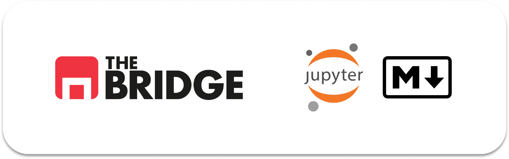

# 📘 Sprint 01 · Bloque 01

## Introducción a las Herramientas — Teoría

En este bloque se presenta el entorno de trabajo del bootcamp y se introduce **Markdown**, el lenguaje de marcado ligero que usarás a lo largo del curso para documentar notebooks, escribir READMEs y comunicarte con herramientas de IA.

---

## 📂 Contenido de la teoría

---

### ✍️ 1. Introducción a Markdown

🔗 [Abrir documento](./intro_markdown.md)

Este documento explica qué es Markdown, para qué se usa y cómo aplicar su sintaxis en Jupyter, GitHub y otros entornos del bootcamp.

**¿Qué aprenderás?**

* Qué es Markdown y por qué es relevante en el mundo de la IA
* Cómo usar celdas Markdown en Jupyter y Google Colab
* Sintaxis esencial: títulos, énfasis, listas, enlaces e imágenes
* Bloques de código con resaltado de sintaxis
* Tablas, citas, reglas horizontales y listas de tareas (GFM)
* Buenas prácticas para estructurar documentos claros y legibles

---

### 🔧 2. GitHub y tu Repositorio de Clase

🔗 [Abrir documento](../../../Sprint_00/guia_uso_git.md)

Esta guía te explica cómo usar GitHub para gestionar tu código, clonar repositorios y mantener tu trabajo sincronizado con el del bootcamp.

**¿Qué aprenderás?**

* Qué es Git y GitHub, y por qué son esenciales en desarrollo
* Cómo configurar tu cuenta de GitHub e instalar Git
* Clonar el repositorio de clase y mantenerlo actualizado
* Crear tu propio repositorio para los ejercicios del bootcamp
* Comandos básicos de Git y la terminal
* Cómo resolver errores comunes

---

### 💻 3. VSCode para Trabajar con Ficheros

🔗 [Abrir documento](../../../Sprint_00/guia_vscode.md)

Esta guía te introduce a Visual Studio Code, el editor que usarás para escribir y editar código Python, Jupyter notebooks y otros archivos.

**¿Qué aprenderás?**

* Instalación y configuración inicial de VSCode
* Interfaz principal: explorador, editor, terminal integrada
* Cómo abrir, crear y organizar archivos y carpetas
* Atajos de teclado y búsqueda avanzada
* Extensiones esenciales: Python, Jupyter, Data Wrangler, Git Graph
* Trabajar con Jupyter notebooks (.ipynb) y kernels
* Significado de colores e iconos en el explorador
* Guardar, sincronizar y resolver errores comunes

---

### ☁️ 4. Google Colab para los Workouts

🔗 [Abrir documento](../../../Sprint_00/guia_uso_colab.md)

Esta guía te explica cómo usar Google Colab, la plataforma en la nube donde trabajarás con los notebooks de los Workouts del bootcamp.

**¿Qué aprenderás?**

* Qué es Google Colab y similitudes con VSCode
* Configuración inicial: conectar GitHub a Colab (5 pasos sencillos)
* Cómo abrir Workouts directamente en Colab
* Ejecución de celdas y gestión de notebooks en la nube
* Alternativa: trabajar localmente con VSCode
* Limitaciones de Colab (tiempo, RAM, almacenamiento)
* Solución de errores comunes
